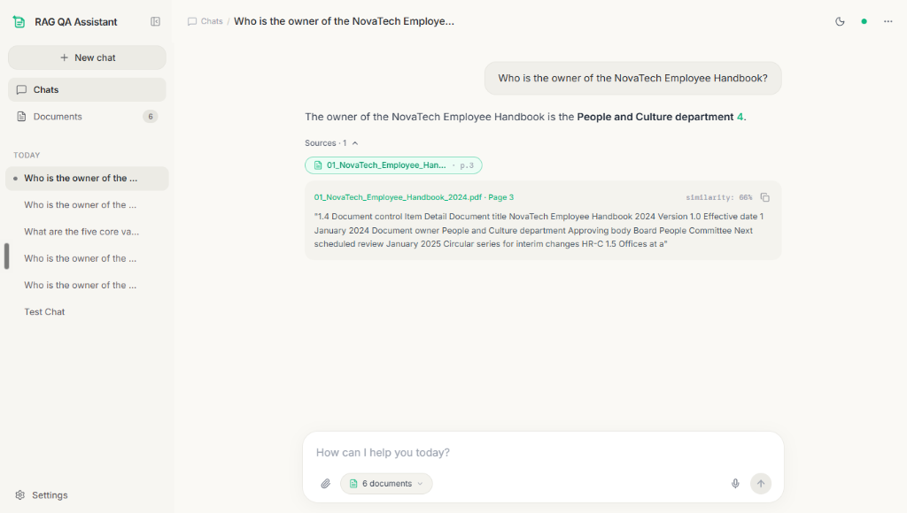
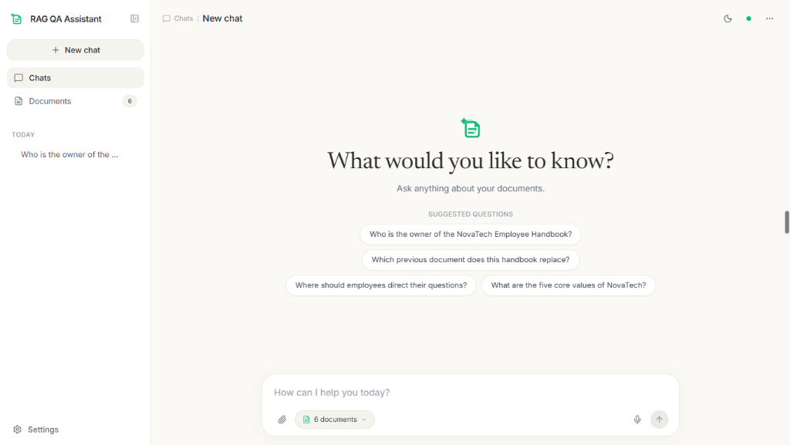
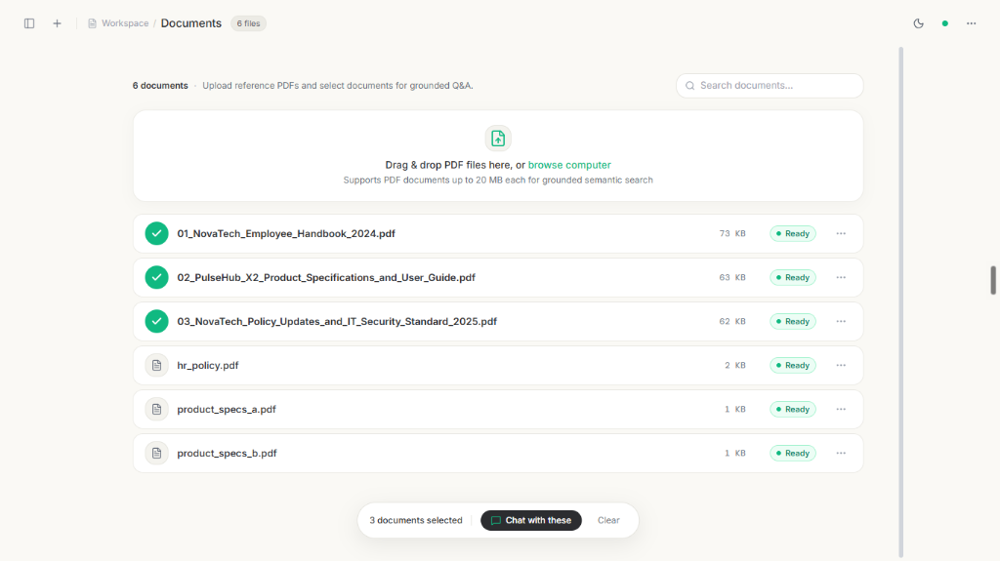
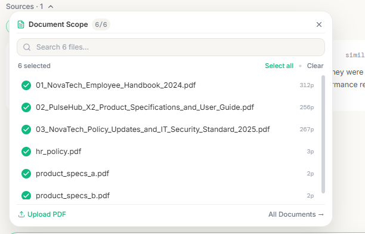
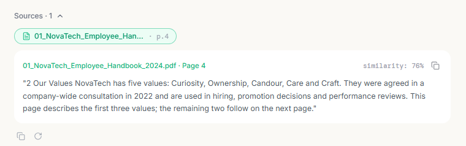

# GroundTruth: AI Document Assistant with Source-Backed Answers (RAG)

[](https://github.com/MuhammadNabeelIjaz/GroundTruth-RAG)
[](https://fastapi.tiangolo.com)
[](https://react.dev)
[](https://www.typescriptlang.org)

A full-stack **Retrieval-Augmented Generation (RAG)** application for grounded document question-answering with verifiable, physical page-level citations.

---

## 1. Project Overview

**GroundTruth: AI Document Assistant with Source-Backed Answers (RAG)** is an internal knowledge-base question-answering system designed to answer user inquiries strictly from uploaded reference PDFs. It enforces grounded generation: when uploaded documents lack sufficient facts to answer a question, the assistant explicitly refuses to answer rather than extrapolating or hallucinating.

The application pairs a **FastAPI (Python)** backend with a **React 19 + TypeScript + Vite** frontend, utilizing local vector search via **ChromaDB**, local ONNX embeddings via **all-MiniLM-L6-v2**, and LLM inference powered by the **Groq API**.

---

## 2. UI Preview & Screenshots

Experience the Claude-inspired user experience and source-backed answers:

### 💬 Grounded Q&A with Physical Page Citations
Ask complex questions about your documents. Verified inline badges (`[4]`) link directly to physical page excerpts and similarity confidence scores.



<br/>

### 🌟 Conversational Welcome Canvas & Prompt Discovery
Minimalist welcome screen with contextual question recommendations derived from your uploaded reference documents.



<br/>

### 📚 Knowledge Base Management & Batch Ingestion
Full-featured document library featuring drag-and-drop batch PDF ingestion, real-time status indicators, and multi-document filtering.



<br/>

### 🎯 In-Chat Granular Document Scope Selector
Filter retrieval scope directly from the composer pill without leaving the chat conversation.

<p align="center">
  
</p>

<br/>

### 🔍 Interactive Verbatim Citation Verification
Inspect the exact supporting excerpt retrieved from the physical PDF page with cosine similarity scores and one-click copy.

<p align="center">
  
</p>

---

## 3. Current Development Status

> [!IMPORTANT]
> **DEVELOPMENT IN PROGRESS (PROTOTYPE / DEMONSTRATION PHASE)**
> This project is an active development prototype and demonstration tool. It is **not yet complete, production-hardened, or intended for multi-tenant cloud deployment**. Core retrieval, generation, citation tracking, and multi-turn query rewriting are functional and verified locally, but several production features (such as API authentication, progressive streaming, and table extraction) remain under active development.

---

## 4. Features Implemented & Verified

### Ingestion & Vector Storage
- **PDF Upload & Validation**: Uploads are validated against magic bytes (`%PDF-`), capped at 20 MB (configurable), and checked for corruption.
- **Physical Page Tracking**: Pages are extracted via PyMuPDF (`fitz`), preserving 1-based physical PDF page numbers across all downstream chunks and citations.
- **Token-Aware Chunking**: Chunks text by paragraph and sentence boundaries, respecting the 256-token sequence ceiling of the embedding model.
- **Local ONNX Embeddings**: Runs inference locally via `onnxruntime` using ChromaDB's built-in `all-MiniLM-L6-v2` model (384 dimensions), eliminating PyTorch dependencies.
- **Persistent Vector Store**: ChromaDB embedded client with persistent cosine-distance HNSW indexing (`backend/data/chroma`).
- **Complete Document Lifecycle**: Full upload, indexing, retrieval, document deletion (with disk and vector store cleanup), and re-ingestion cycle verified.

### Grounded Retrieval & Answer Generation
- **Strict RAG Prompting**: 7-rule system prompt instructing the model to rely solely on context and refuse speculation.
- **Verifiable Citations**: Returns source document name, physical PDF page number, similarity score badge (≥70% green, 40–69% amber, <40% red), and exact matching text excerpt.
- **Refusal Detection**: Multi-stage clause analysis distinguishing genuine insufficiency refusals from affirmative factual answers containing secondary caveats.
- **Document Scope Filtering**: Users can query across all indexed documents or restrict searches to explicitly selected files.
- **Configurable Retrieval Parameters**: User-adjustable Top-K (1–20) and Minimum Similarity (0%–80%) threshold sliders.

### Multi-Turn Conversation
- **Conversational Query Rewriting**: Resolves ambiguous follow-up pronouns (e.g. *"it"*, *"that product"*, *"how does that compare"*) into standalone queries before vector retrieval.
- **Session Persistence**: Complete conversation history and citation metadata stored locally in SQLite with Write-Ahead Logging (WAL) enabled (`backend/data/conversations.db`).
- **Session Management**: Create, list, reopen, rename, and delete conversation threads.

### User Interface
- **Unified Composer**: Drag-and-drop PDF attachments, auto-expanding textarea, Enter-to-send, and keyboard shortcuts.
- **Interactive Citations Drawer**: Expandable source cards displaying verified excerpts and physical page tags. Clickable inline `[Passage N]` chips scroll smoothly to supporting cards.
- **Suggested Questions**: Contextual prompt chips generated for indexed documents.
- **Voice Dictation**: Browser-native Web Speech API speech-to-text dictation with live audio waveforms (no external API key required).
- **Responsive Layout**: Collapsible sidebar, mobile slide-over drawer, and adaptive layouts tested down to 390px mobile viewports.

---

## 5. Partially Implemented & Transitional Features

- **Standard Response Mode**: Responses are currently generated and returned synchronously as complete payloads. Progressive token-by-token streaming via Server-Sent Events (SSE) is not supported.
- **Document Suggestions Cache**: Suggestion questions are cached in-memory and re-generated on server restart.
- **Stateless Chat Endpoint**: A legacy stateless `/chat` route exists alongside the stateful `/conversations/{id}/messages` pipeline.

---

## 6. Technology Stack

### Backend
- **Language**: Python 3.11+
- **Framework**: FastAPI `>=0.115,<1.0`, Uvicorn `>=0.30`
- **Configuration**: Pydantic Settings v2 (`pydantic-settings>=2.2`)
- **PDF Extraction**: PyMuPDF `>=1.28,<2.0`
- **Vector Database**: ChromaDB `>=1.5.9,<2.0` (embedded PersistentClient)
- **Local Embeddings**: ONNX Runtime (`onnxruntime>=1.18.0,<2.0`), Tokenizers (`tokenizers>=0.19.0,<1.0`)
- **Conversation Store**: SQLite3 (standard library, WAL mode)
- **LLM Provider**: Groq API via HTTPX (`httpx>=0.27`)
- **Testing**: Pytest `>=8.0`

### Frontend
- **Framework**: React `19.3.1`
- **Build Tool**: Vite `8.3.8`
- **Language**: TypeScript `~7.0.2`
- **Styling**: Tailwind CSS `^3.4.17`
- **Icons**: Lucide React `^1.72.0`
- **Markdown**: React Markdown `^10.1.0`, Remark GFM `^4.0.1`
- **HTTP Client**: Axios `^1.21.1`

---

## 7. Folder and File Structure

```
.
├── backend/
│   ├── api/                      # FastAPI route controllers
│   │   ├── chat.py               # Stateless single-turn chat endpoint (/chat)
│   │   ├── conversations.py      # Stateful multi-turn chat sessions (/conversations)
│   │   ├── documents.py          # PDF upload, listing, deletion, suggestions (/documents)
│   │   └── search.py             # Direct vector similarity search (/search)
│   ├── conversation/             # SQLite conversation persistence
│   │   └── store.py              # Schema, WAL setup, session & message CRUD
│   ├── data/                     # Local data storage (git-ignored)
│   │   ├── chroma/               # Local ChromaDB persistent HNSW indices
│   │   ├── sample_pdfs/          # Benchmark and sample test documents
│   │   ├── uploads/              # Uploaded PDF document storage
│   │   └── conversations.db      # SQLite chat history database
│   ├── generation/               # LLM interaction & citation verification
│   │   ├── answer_service.py     # End-to-end RAG orchestrator & refusal detector
│   │   ├── citations.py          # [Passage N] parsing & lexical overlap validation
│   │   ├── llm_client.py         # Groq HTTP client & tag sanitizer
│   │   ├── prompts.py            # Strict grounding system prompts & context formatting
│   │   └── rewriter.py           # Multi-turn conversational query reformulation
│   ├── ingestion/                # PDF parsing and chunk segmentation
│   │   ├── chunker.py            # Page-aware paragraph and sentence chunker
│   │   ├── pdf_loader.py         # PyMuPDF text & physical page extractor
│   │   └── pipeline.py           # Ingestion pipeline coordinator
│   ├── retrieval/                # Vector store abstractions & embedding adapters
│   │   ├── embedder.py           # Abstract embedder base class
│   │   ├── retriever.py          # Similarity search with document name filtering
│   │   ├── services.py           # Singleton service factories & test overrides
│   │   ├── st_embedder.py        # ONNX MiniLM runtime adapter with ST fallback
│   │   └── vector_store.py       # ChromaDB PersistentClient wrapper
│   ├── tests/                    # Automated test suite (546 tests)
│   │   ├── unit/                 # Unit tests for all backend modules
│   │   ├── regression/           # End-to-end regression benchmarks
│   │   └── conftest.py           # Pytest fixtures and tmp isolation guards
│   ├── config.py                 # Centralized Pydantic settings
│   ├── logging_config.py         # Application logging configuration
│   ├── main.py                   # FastAPI application initialization & CORS
│   ├── requirements.txt          # Python package requirements
│   ├── schemas.py                # Pydantic request/response schemas
│   └── .env.example              # Backend environment variable template
│
├── frontend/
│   ├── src/
│   │   ├── components/           # UI components (ChatArea, Composer, SettingsModal, etc.)
│   │   ├── context/              # React Context state providers (ChatContext, DocumentContext)
│   │   ├── hooks/                # Custom React hooks (useVoiceInput, useUploadTray)
│   │   ├── services/             # API client methods (api.ts)
│   │   ├── types/                # TypeScript interfaces and schemas
│   │   ├── App.tsx               # Main application container
│   │   └── main.tsx              # React DOM root entry point
│   ├── package.json              # Frontend package definitions
│   ├── package-lock.json         # Pinned dependency lockfile
│   ├── tsconfig.json             # TypeScript compiler configuration
│   ├── vite.config.ts            # Vite bundler & reverse proxy rules
│   └── .env.example              # Frontend environment variable template
│
├── docs/                         # Architecture guides and specifications
│   └── RAG_PIPELINE.md           # Component-level design and lifecycle reference
│
├── start_backend.bat             # Windows one-click backend launcher
├── start_frontend.bat            # Windows one-click frontend launcher
├── IMPLEMENTATION_PLAN.md        # Technical implementation & defect remediation plan
├── FINAL_END_TO_END_VERIFICATION_REPORT.md  # End-to-end workflow verification audit
└── README.md                     # Project documentation
```

---

## 8. Prerequisites

| Tool | Version Requirement | Notes |
|---|---|---|
| **Python** | `3.11+` | Tested on Python 3.12.4 |
| **Node.js** | `20.19+` or `22.12+` (or `24+`) | **Vite 8 dropped support for Node.js 18** |
| **npm** | `9+` or `10+` | Compatible with lockfile v3 |
| **Groq API Key** | Valid API account | Free tier available at https://console.groq.com |

---

## 9. Installation & Setup

### 0. Clone the Repository

```bash
git clone https://github.com/MuhammadNabeelIjaz/GroundTruth-RAG.git ground_root_rag
cd ground_root_rag
```

### 1. Backend Setup

```bash
cd backend

# Create and activate a Python virtual environment
python -m venv .venv

# Windows activation:
.venv\Scripts\activate

# macOS / Linux activation:
# source .venv/bin/activate

# Install required Python packages
pip install -r requirements.txt

# Configure environment variables
cp .env.example .env
```

Open `backend/.env` in a text editor and provide your Groq API key:
```env
GROQ_API_KEY=gsk_your_actual_key_here
```

### 2. Frontend Setup

```bash
cd frontend

# Install Node.js packages
npm install

# Configure environment variables (optional - defaults to http://127.0.0.1:8000)
cp .env.example .env
```

---

## 10. Environment Variables

### Backend Configuration (`backend/.env`)

| Variable | Type | Default | Description |
|---|---|---|---|
| `GROQ_API_KEY` | string | *None (Required)* | Groq API authentication key |
| `LLM_MODEL` | string | `qwen/qwen3.8-27b` | Model identifier for Groq generation |
| `LLM_TEMPERATURE` | float | `0.0` | Generation temperature (0.0 enforces strict determinism) |
| `LLM_TIMEOUT_SECONDS` | float | `30.0` | Maximum timeout for LLM inference requests |
| `EMBEDDING_MODEL` | string | `sentence-transformers/all-MiniLM-L6-v2` | Dense embedding model identifier |
| `EMBEDDING_BATCH_SIZE` | integer | `32` | Maximum chunk batch size during embedding |
| `CHROMA_DIR` | path | `backend/data/chroma` | Persistence directory for ChromaDB vector store |
| `CHROMA_COLLECTION_NAME`| string | `document_chunks` | Collection name in ChromaDB |
| `UPLOADS_DIR` | path | `backend/data/uploads` | Filesystem storage path for uploaded PDFs |
| `MAX_UPLOAD_MB` | integer | `20` | Maximum upload size per PDF file |
| `CHUNK_SIZE` | integer | `300` | Target character size per chunk |
| `CHUNK_OVERLAP` | integer | `50` | Character overlap between consecutive chunks |
| `TOKEN_AWARE_CHUNKING` | boolean | `true` | Enforces 256-token hard ceiling per chunk |
| `RETRIEVAL_TOP_K` | integer | `5` | Default number of passages retrieved per query |
| `MIN_SIMILARITY` | float | `0.0` | Default minimum cosine similarity score threshold |
| `CONVERSATIONS_DB_PATH` | path | `backend/data/conversations.db` | SQLite database path for chat persistence |
| `MAX_HISTORY_TURNS` | integer | `10` | Maximum prior turns passed to query rewriter |
| `CORS_ORIGINS` | list | `["http://localhost:5173", "http://127.0.0.1:5173"]` | Allowed frontend browser origins |
| `LOG_LEVEL` | string | `INFO` | Console logging level (DEBUG, INFO, WARNING, ERROR) |

### Frontend Configuration (`frontend/.env`)

| Variable | Type | Default | Description |
|---|---|---|---|
| `VITE_API_BASE_URL` | string | `http://127.0.0.1:8000` | Target URL of the backend FastAPI server |

---

## 11. How to Run the Project

### Windows One-Click Launchers
From the project root directory:
1. Double-click **`start_backend.bat`** (Starts FastAPI server on `http://127.0.0.1:8000`).
2. Double-click **`start_frontend.bat`** (Starts Vite dev server on `http://127.0.0.1:5173`).
3. Open **`http://localhost:5173`** in your browser.

### Manual Command Line Launch

**Terminal 1 (Backend):**
```bash
cd backend
.venv\Scripts\activate
python -m uvicorn backend.main:app --host 127.0.0.1 --port 8000 --reload
```

**Terminal 2 (Frontend):**
```bash
cd frontend
npm run dev -- --host 127.0.0.1 --port 5173
```

---

## 12. End-to-End Application Workflow

```
[ 1. User Uploads PDF ]
          │
          ▼
[ 2. Ingestion & Validation ]  ──► Validates %PDF- header, enforces 20MB limit
          │
          ▼
[ 3. Page-Aware Chunking ]     ──► Extracts text via PyMuPDF; tracks physical page numbers;
          │                        enforces ≤256 token ceiling per chunk
          ▼
[ 4. Local ONNX Embeddings ]   ──► Generates 384-dimensional vectors via all-MiniLM-L6-v2
          │
          ▼
[ 5. ChromaDB Persistence ]    ──► Stores chunk text, page metadata, and vectors in HNSW index
          │
          ▼
[ 6. User Submits Question ]   ──► Query received via /conversations/{id}/messages
          │
          ▼
[ 7. Multi-Turn Rewriting ]    ──► Reformulates pronouns ("it", "that") into standalone queries
          │
          ▼
[ 8. Dense Cosine Retrieval ]  ──► Retrieves top-K chunks filtered by selected document scope
          │
          ▼
[ 9. LLM Grounded Generation ] ──► Formats context with [Passage N] tags; calls Groq API
          │
          ▼
[ 10. Citation Validation ]    ──► Verifies [Passage N] tags; validates lexical overlap;
          │                        evaluates refusal conditions; persists turn to SQLite
          ▼
[ 11. Frontend Rendering ]     ──► Renders grounded response with interactive source cards
```

---

## 13. Verified API Endpoints

All endpoints below have been verified via automated integration and live HTTP tests:

### Health
- `GET /health`: Returns service name, version, and server status.

### Documents (`/documents`)
- `POST /documents`: Multipart file upload accepting one or more PDF files. Returns page counts, chunk counts, and indexing status.
- `GET /documents`: Lists all uploaded documents, file sizes, chunk counts, and indexed states.
- `DELETE /documents/{file_name}`: Deletes the stored PDF and purges all corresponding vector chunks from ChromaDB.
- `GET /documents/{file_name}/suggestions`: Returns 4 suggested questions grounded in the specified document.
- `POST /documents/rebuild`: Re-reads PDFs from disk uploads and completely rebuilds the ChromaDB vector index.

### Conversations (`/conversations`)
- `POST /conversations`: Creates a new conversation session thread.
- `GET /conversations`: Lists saved conversations ordered by last update timestamp.
- `GET /conversations/{conversation_id}`: Retrieves full message history and source citations for a session.
- `DELETE /conversations/{conversation_id}`: Deletes a conversation session and cascades deletion of its messages.
- `POST /conversations/{conversation_id}/messages`: Submits a question within a session; performs query rewriting, vector retrieval, answer generation, and updates session history.

### Search (`/search`)
- `POST /search`: Direct dense retrieval endpoint. Accepts `query`, `file_names`, `top_k`, and `min_similarity`; returns ranked chunks with similarity scores.

### Stateless Chat (`/chat`)
- `POST /chat`: Legacy single-turn question-answering endpoint without session persistence.

---

## 14. Known Limitations

- **Complex Table Extraction**: PyMuPDF extracts text streams line-by-line (`page.get_text("text")`). Multi-column tables and comparative matrices are flattened into linear text, which can degrade retrieval precision for tabular lookups.
- **Single-Process Storage Locks**: SQLite conversation storage and local ChromaDB persistent directories are designed for single-process operation. Running multiple Uvicorn worker processes (`--workers > 1`) will cause database lock contention.
- **Single-Tenant Prototype**: The API currently lacks multi-user authentication (JWT / Bearer tokens) and per-user data tenancy. All clients on the network can access indexed documents and conversations.
- **Voice Dictation Browser Support**: Voice input uses the browser-native Web Speech API. Full support is currently restricted to Chromium-based browsers (Google Chrome, Microsoft Edge, Brave). Mozilla Firefox does not support this API natively.
- **No Token Streaming**: Generation is synchronous; the complete answer and citation set are returned together rather than streamed word-by-word.

---

## 15. Pending Development Tasks

The following capabilities are planned for upcoming development iterations:
1. **Server-Sent Events (SSE) Streaming**: Implement token-by-token streaming response generation with trailing citation payloads.
2. **Table-Aware Document Extraction**: Integrate PyMuPDF `page.find_tables()` or structured table parsing to preserve rows and columns.
3. **Hybrid Retrieval**: Combine dense semantic vector search with sparse keyword search (BM25) and Reciprocal Rank Fusion (RRF).
4. **Cross-Encoder Reranking**: Add a lightweight reranking stage (e.g. FlashRank / BGE-Reranker) to improve top-K relevance.
5. **API Authentication & Multi-Tenancy**: Add user authentication, request rate limiting, and isolated workspace partitions.
6. **Containerization**: Create production `Dockerfile` and `docker-compose.yml` configurations for deployment.

---

## 17. Production Deployment (Netlify + Render)

The project is pre-configured for frictionless cloud deployment:
- **Frontend**: Deploy on [Netlify](https://www.netlify.com) using [`netlify.toml`](netlify.toml) and SPA redirects.
- **Backend**: Deploy on [Render](https://render.com) using the [`render.yaml`](render.yaml) blueprint specification or manual Web Service.
- **Flexibility**: Both build-time environment variable (`VITE_API_BASE_URL`) and in-app runtime switching (**Settings -> About -> Backend Connection URL**) are supported. Automatic regex CORS allows all Netlify preview and production URLs out-of-the-box.

For complete, step-by-step instructions, see the **[Full Deployment Guide](docs/DEPLOYMENT.md)**.


The project includes an extensive automated test suite enforcing isolation: tests generate synthetic PDFs in-memory and write temporary files strictly to pytest sandbox directories, leaving production data directories untouched.

```bash
# Run backend test suite
cd backend
.venv\Scripts\activate
python -m pytest tests/ -v
```

### Verified Test Results
- **Pytest Suite**: **546 passed, 1 skipped** (100% pass rate).
  - PDF extraction, corrupt PDF rejection, password-protected PDF rejection.
  - Page-boundary preservation, token limit guards, character chunking.
  - ChromaDB cosine similarity, metadata filtering, chunk deletion.
  - Grounded answer generation, prompt construction, multi-stage refusal detection matrix.
  - SQLite WAL persistence, conversation CRUD, cascading message deletion.
  - Conversational query rewriting for multi-turn sessions.
- **Frontend Compilation & Build**:
  - `npx tsc -b`: **0 errors**.
  - `npm run build`: Production client bundle transforms 2,409 modules and outputs optimized distribution files in **~2.1 seconds**.
